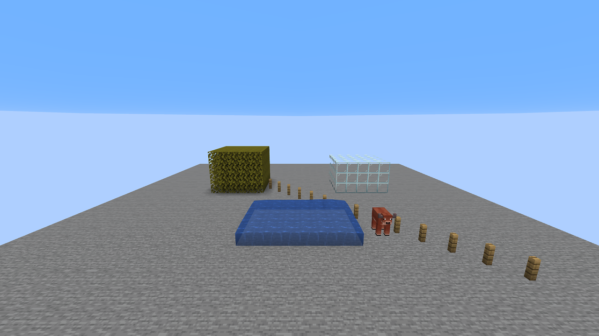

# 0.2.0：TAA Project 对照

参考为用户提供的 `TAA Project.zip`，只读取原文件；其副本及 `CAS_AMOUNT=1.0` 配置放入独立的 `run-smoke/shaderpacks`。正式模组不包含参考包、BSL 源码、Iris 或 Sodium。
算法独立实现，保留参考参数与采样位置。原参考包在 Iris 1.9.6 / Sodium 0.7.2 / Minecraft 1.21.8 中成功启用，没有修改其着色器文件。

| 项目 | 0.2.0 默认模式 |
| --- | --- |
| 抖动 | 固定 8 相位，屏幕空间幅度为参考 clip 偏移的一半 |
| 重投影 | 无抖动矩阵逆变换、上一帧矩阵、相机位置差 |
| 历史裁剪 | RGB 3×3 最小/最大值 |
| 默认历史混合 | `0.3 + 0.6 * exp(-像素运动距离)` |
| 默认锐化 | `1.5*中心 - 0.125*四个相邻像素之和`，输出限制在 0～1 |
| 可选锐化 | CAS，默认强度 1.00 |

参考包的配置只覆盖 CAS_AMOUNT；SHARPENING 仍是默认的 1，即 Unsharp。模组按实际默认类型匹配，并允许 UI 切换 CAS。

## 实测

两个独立启动使用相同构建场景、相机位置、1280×720 分辨率，冻结世界并关闭云，采集 32 帧。
区域为 `(80,280)` 起点、1120×100 像素。指标为 RGB 8 位值平均时域方差的平方根，越低表示该区域帧间变化越小。

| 实现 | 时域 RMS |
| --- | --- |
| 原光影包 + Iris/Sodium | 0.7807 |
| 原光影包重复运行 | 0.7443 |
| 模组 0.2.0 首次实测 | 0.7747 |
| 模组 0.2.0 最终回归（含 Mod Menu） | 0.8161 |
| 模组 0.1.1 上次实测 | 2.0914 |

原始结果：`reference-stability.json`、`reference-stability-repeat.json`、`stability-reference-mode.json`（模组最终回归）。
该指标只反映此场景的静态区域变化，不能证明运动画质、拖影或逐像素一致。不同渲染路径也影响指标。

可见场景边缘已接近；天空渐变、玻璃顶部等仍有差异。模组保持原版材质、雾、天空与手部渲染，参考包则通过 gbuffer 着色器参与这些阶段。
未实现实体运动矢量，运动实体仍可能拖影。当前版本在检测到 Iris/Sodium 时停用自身 TAA，两个后处理不叠加。

常规构建与回归：`gradlew.bat build runSmokeClient -Pstability -PwithModMenu`。
结果 BUILD SUCCESSFUL。4 个数学测试通过，真实客户端验证历史累积、开关、转动视角、CAS 切换、缩放、资源重载、中英文 UI、旧模式预设及配置保存。
参考对照：先将包与配置副本放入独立实例，再运行 `gradlew.bat runSmokeClient -PreferenceShader -Pstability`。
参考测试依赖只在指定该参数时加入；Gradle 自动从 Iris JAR 展开所需内嵌 Java 库。
