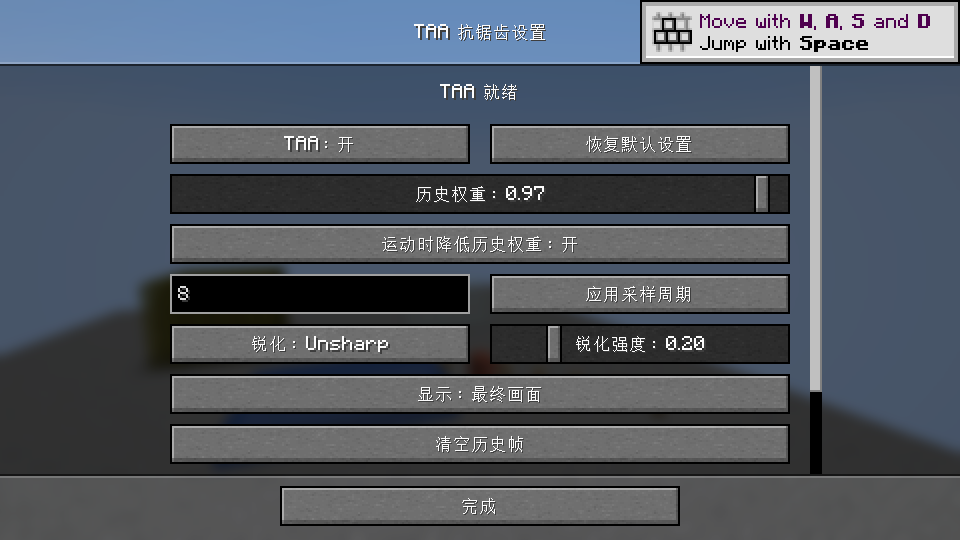
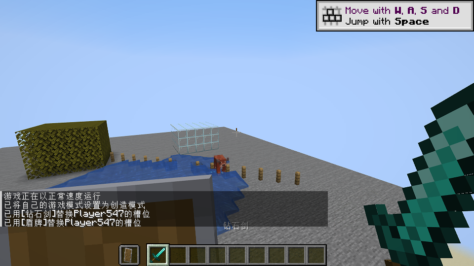
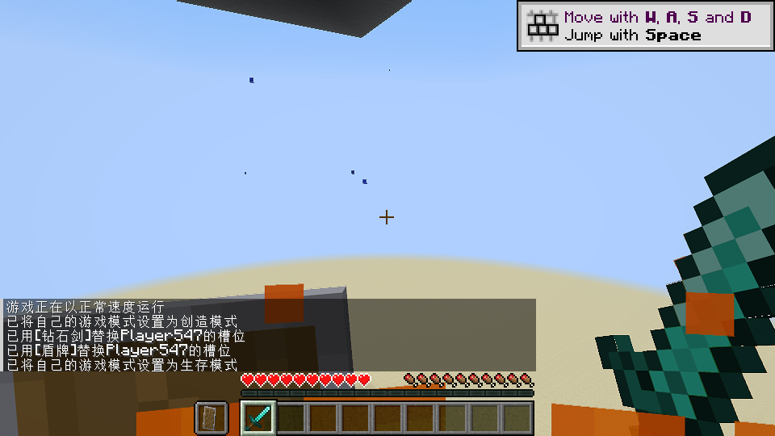
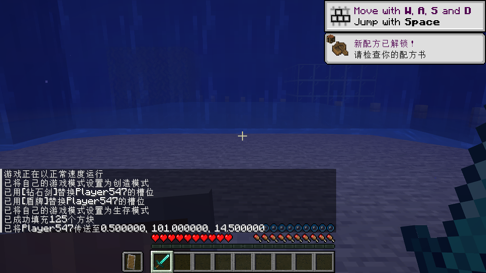
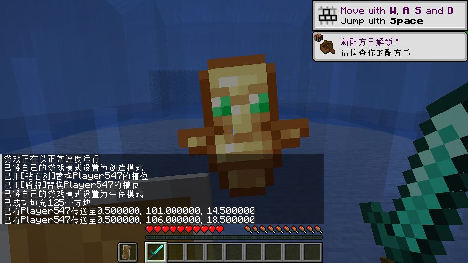
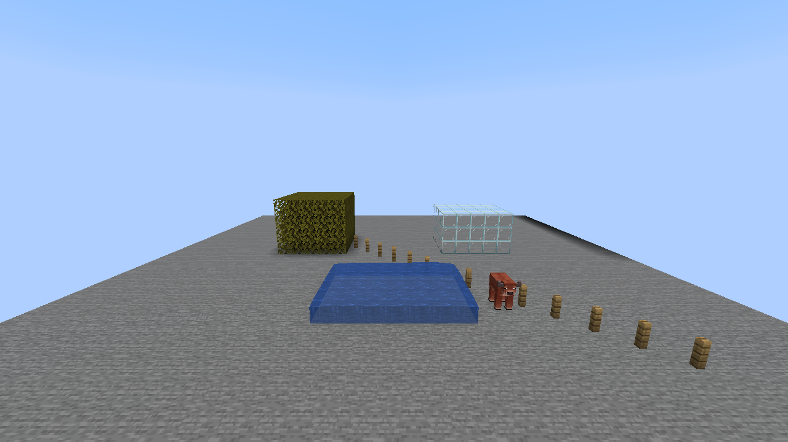

# 验证记录

## 0.5.0：SSAA 超采样

保留 TAA，新增 SSAA 模式；4×、9×、16×分别将宽高扩大 2、3、4 倍。3D 帧段使用独立目标和对应窗口/全局着色参数，世界、手部、场景特效及描边完成后恢复原目标，用两个方向的 Lanczos 滤波缩小，再复用可选锐化。HUD 和菜单保持原尺寸。超过设备纹理尺寸上限时不进入高分辨率渲染，并显示降低倍率提示。

中英文设置新增模式及倍率按钮。SSAA 下 TAA 专属控件禁用，切换模式不重建控件；连续切换 20 次无叠加。禁用的采样输入即使为空也不阻止关闭 SSAA 设置；模式和倍率保存读取通过。默认保持原有 TAA，SSAA 默认 4×。

构建和两组完整客户端回归均 BUILD SUCCESSFUL，9 项数学/精度测试通过。第二组同时加载 Iris 1.9.6、Sodium 0.7.2、Mod Menu 15.0.2，光影包关闭；生产代码不检测这些渲染模组的安装状态。

| 测试 | 3D 渲染尺寸 | 最终输出尺寸 |
| --- | --- | --- |
| SSAA 4× | 2560×1440 | 1280×720 |
| SSAA 9× | 3840×2160 | 1280×720 |
| SSAA 16× | 5120×2880 | 1280×720 |
| 4×窗口缩放 | 1920×1080 | 960×540 |

开发专用观察钩子在世界/手部绘制阶段验证实际目标、窗口参数与描边尺寸；在客户端 tick 验证已恢复原始目标及尺寸，并确认 SSAA 没有 TAA 历史。截图检查世界、远处玻璃、剑、盾、HUD 与界面。关闭后高分辨率缓冲释放，资源重载、Fabulous 和切回 TAA 的回归均通过。
TAA 静态世界 32 帧 RMS：普通渲染路径 **0.2039**，Iris/Sodium 同装 **0.1568**。此数值只描述 TAA 原有稳定性回归，不作为 SSAA 画质或帧率指标。

证据：`ssaa-client-validation.log`、`ssaa-render-mods-validation.log`；截图 `ssaa-4x.png`、`ssaa-settings.png`。SSAA 采用全分辨率着色，倍率提高会增加 GPU 和显存负担，未给出帧率保证；未测试启用光影包的组合。

## 0.4.4：静止远处玻璃的实际可见度

0.4.3 的颜色精度补偿不足以解决普通玻璃的可见度问题。原版普通玻璃使用 CUTOUT，玻璃板使用 CUTOUT_MIPPED；细边被抖动采样跳过时，当前像素是背景，单纯颜色混合与裁剪会把细边历史冲淡。

复用现有 DEPTH32 历史：下半区间编码第一人称前景深度，上半区间编码世界深度。静止时当前像素变成更远的背景，且 3×3 邻域仍有与旧深度相符的表面，才重建覆盖并保留表面历史深度。对确认位于背景缺口边缘的匹配表面，只平均同深度、相近颜色且不属于手部的邻域样本，再进行连续的时间重建与历史混合，减少不同抖动帧的色差。新表面保持正常混合，避免直接刷新样本引入闪动。相机移动时走原有重投影与裁剪。静止历史和最终输出改为精确像素读取。
世界与手部抖动周期及幅度保持原有设置，没有额外透明材质投影、渲染通道钩子或独立缓冲。0.4.4 相对 0.4.3 不增加缓冲或绘制次数；覆盖变化像素和颜色高频的匹配表面检查邻域深度，颜色重建只用于确认存在背景缺口的细边。

新增 `-PglassQuality -Pstability` 专用客户端测试：同一视角、白天光照、约 65 格外单层玻璃墙，关闭 TAA、开启初期、继续静止约 20 秒及移除整面玻璃各采集 16 张图像。区域 `(575,230,132,62)`，对比度指标为 RGB 与该行两侧天空颜色的平均绝对差。

| 版本 | 关闭 TAA | 开启初期 | 长期静止 | 长期/关闭 |
| --- | ---: | ---: | ---: | ---: |
| 0.4.3 | 12.3448 | 6.7119 | 6.7362 | 54.6% |
| 0.4.4 | 12.3448 | 10.2935 | 10.4380 | 84.6% |

验收：长期对比度介于关闭 TAA 的 80%～130%，且不低于初期的 90%；玻璃区域 16 帧 RGB 8 位时域 RMS 小于 0.8，实际为 **0.7533**。移除后的残留对比度小于 0.5，实际为 **0.0**。数据为 `glass-quality-0.4.3.json`、`glass-quality-0.4.4.json`，截图为 `glass-static-0.4.4.png`、`glass-removed-0.4.4.png`。
完整客户端回归 BUILD SUCCESSFUL，9 项数学/精度测试通过，世界、手部、特效、UI、Mod Menu、缩放、重载、调试视图和配置保存全部通过。世界静态区域 32 帧 RMS 为 **0.2082**，原始数据为 `stability-glass-0.4.4.json`。
这组指标证明该玻璃场景的可见度、稳定性与历史清除，不能代表所有材质、距离与背景；修复可能让亚像素细边略宽。测试同时约束对比度上下限与时域波动。

## 0.4.3：远处玻璃弱对比细节

修复 RGBA8 历史颜色在 0.97 等高权重下的舍入停滞：增加双缓冲残差纹理，用线性采样恢复亚字节颜色变化。零残差编码为 128，防止 100% 权重下中性残差漂移。移除把纯黑历史当成无效历史的判断，历史有效性仍由有效标志与覆盖层判断控制。
静止时颜色裁剪增加 2/255 的有限余量，随像素运动快速收紧，避免细边覆盖变化直接抹掉微弱历史。未提高默认锐化或改动历史权重范围。

精度测试验证弱对比恒定颜色收敛、只在八相位之一出现的亚像素细节平均覆盖、100% 历史权重的可精确表示颜色无漂移。另有原有六项投影与采样数学测试。
真实客户端完整回归通过，新增约 65 格外单层玻璃墙；静态视角和光照固定后，32 帧区域 RMS 为 **0.2654**，数据为 `stability-glass.json`，截图为 `glass-static.png`。该区域指标检查稳定性；数学测试证明精度损失修复，不代表所有距离和材质组合的感知清晰度。
首次采样期间相机移动且时间被改为夜晚，RMS 47.92，该次不作为静态质量结果；测试代码现固定测量阶段的位置、角度和白天光照。
成本：额外一次全屏解析绘制、8 字节/像素残差存储，1080p 约 15.8 MiB。UI、Mod Menu、手部、特效、缩放和重载回归继续执行。

## 0.4.2：历史权重与运动衰减

历史权重允许 0～1，默认 0.97。新增“运动时降低历史权重”开关，默认开启；关闭时对有效历史保持设定权重。前景覆盖判断、邻域裁剪和历史重置条件继续生效。
验证 1.00 权重及关闭开关的配置保存/读取，恢复默认返回 0.97 和开启状态。真实客户端手部、挥动与移动阶段额外使用 1.00 且关闭衰减，屏幕特效阶段恢复默认开启状态。
中英文界面、Mod Menu、重复点击、采样周期、缩放、重载及调试视图继续执行回归。
构建与真实客户端回归 BUILD SUCCESSFUL，6 个数学测试通过。100% 且关闭运动衰减的手部/移动分支回归通过；默认设置静态区域 RMS 为 0.2886，原始值为 `stability-history.json`。

## 0.4.1：移除兼容性判断与 Mod Menu 入口

删除 Compatibility 类及所有相关调用，生产代码不检测 Iris/Sodium 安装状态，不因它们已安装而停用 TAA。同步删除相应停用文案。
Mod Menu 为可选集成，`fabric.mod.json` 注册 `modmenu` 入口，配置工厂创建 TAA 设置页并保留模组列表作为返回页面。
在 Mod Menu 15.0.2 中通过实际配置注册表验证 `hasConfigScreen("taa")`，从 `ModsScreen.safelyOpenConfigScreen("taa")` 打开配置，关闭后返回模组列表，再返回标题界面。
该验证检查注册及导航；Iris/Sodium 兼容性依据用户提供的实际测试结果，此次没有追加其渲染组合测试。

## 0.4.0：界面重入与自定义周期

修复按钮重建时向持久布局重复添加控件的问题，开关和恢复按钮直接更新现有控件。设置页初始化不再复用持久布局中的旧控件，F8、视频设置和 Mod Menu 入口防止创建嵌套页面。
名称统一为 TAA，中英文界面移除关联其他光影包的描述。默认 Unsharp 强度改为 0.20；已有用户参数保留，恢复默认时使用新值。
采样周期可输入 1～256 的任意整数，默认 8；不同周期的偏移始终为亚像素尺度，普通周期进行均值居中，1 帧周期无抖动。

回归覆盖：连续点击开关/恢复及重复打开 20 次，控件数量不变；关闭一次即返回视频设置。
验证 1、7、13、64、256 的周期输入，拒绝空值、0、257、999；手部阶段使用 17 帧周期。
6 个数学测试验证采样边界、周期重复、居中、投影与手部变换；客户端继续验证开关、缩放、资源重载、锐化联动、配置读写、手部和特效。
当前截图更新为 0.4.0，下面为历史记录。
`gradlew.bat build runSmokeClient -Pstability -PwithModMenu` 最终结果 BUILD SUCCESSFUL，6 个数学测试通过。静态区域 32 帧 RMS 为 0.6284，结果保存于 `stability-ui-final.json`；测试等待区块渲染完成后才开始采集。

## 0.3.0：单模式、UI 与完整场景

只保留 TAA Project；配置保存后旧模式字段消失。手部和世界使用同幅度抖动，独立投影重投影，在手部、屏幕效果、实体描边和原版后处理结束后执行 TAA。
世界深度在原版清除前保存；历史深度区分前景覆盖，静止轮廓一像素邻域允许保留覆盖历史。HUD 与菜单文字保持原版渲染。

`gradlew.bat build runSmokeClient -Pstability -PwithModMenu`：BUILD SUCCESSFUL。
5 个数学测试通过，包含参考采样、投影偏移、远坐标重投影和手部相机旋转抵消。真实客户端检查：

- 世界历史累积、关闭/重新开启、相机转动、窗口缩放、资源重载。
- 中英文界面，CAS 最小值显示、关闭锐化时禁用滑块、切回 Unsharp 保留值。
- 手持剑与盾牌、挥动、火焰、水下效果、不死图腾激活动画，以及所有调试视图。
- Mod Menu 配置入口与配置保存/读取，发布包不含 smoke 代码。

静态场景 32 帧同一区域 RMS 为 **0.7875**，测量条件沿用下方历史记录；原始值为 `stability-fullscene.json`。
此指标只对应世界区域，不代表手部动画或所有特效的画质。特效测试检查实际启用、截图和有效历史，不是逐像素画质基准。
没有逐物体运动矢量，快速挥动、粒子和透明动画仍可能拖影。

## 0.2.0

默认新增 TAA Project 模式，按用户参考包对齐采样、历史混合、邻域裁剪和锐化。构建及真实客户端回归通过；参考包也在独立实例中成功运行。
同场景时域 RMS：参考包首次 0.7807；模组首次 0.7747，最终含 Mod Menu 回归 0.8161。详细条件、截图与局限见 [参考对照](REFERENCE.md)。
以下为此前版本的历史记录；当前中文设置截图已更新为 0.2.0。

验证版本：Minecraft 1.21.8 / Fabric Loader 0.17.2 / Fabric API 0.136.1+1.21.8 / Java 21。
构建：Gradle 9.7.1 / Loom 1.18.3 / Mojang 官方映射 / 构建 JVM Java 25。

验证命令：`gradlew.bat build runSmokeClient -PwithModMenu`，结果 **BUILD SUCCESSFUL**。

- 3 个数学测试通过：Halton 样本、投影抖动、远坐标相机重投影。
- 在真实客户端与独立测试世界中完成 GPU 着色器编译、绘制和有效历史累积。
- 检查 TAA 关闭后历史失效、重新开启后恢复。
- 检查转动视角、窗口从 1280×720 缩放为 960×540、资源重载后历史恢复。
- 检查 8 / 16 / 32 帧预设，以及当前帧、上一帧历史、历史贡献调试视图。
- 检查中英文设置屏幕、视频设置入口与可选 Mod Menu 15.0.2 的配置工厂。
- 检查配置保存后重新读取，验证数值保留。
- 检查正式 JAR 内包含语言、着色器、Mixin 和许可证，不包含 smoke 测试代码。

示例场景截图（不同时间截取，水面和实体会运动；不是逐像素画质基准）：

此验证不代表所有显卡、渲染模组或光影包的兼容性。尚未完成 GPU 帧耗时基准和实体运动矢量。

## 0.1.1：画面颤抖修正

旧版历史与最终输出跟随抖动后的像素网格，未把采样偏移消除；抖动还被计入运动衰减。修正为稳定输出网格，并同步重建颜色、矩阵和历史深度。
静止边缘采用有限的深度邻域搜索及更宽的颜色裁剪，避免覆盖变化被误判为历史失效。

`gradlew.bat build runSmokeClient -Pstability` 在固定相机、冻结世界、关闭云的同一测试场景中采集 32 帧。
测量区域：1280×720 画面中的 `(80,280)` 起点、1120×100 像素；指标为 RGB 8 位值的平均时域方差平方根。

| 版本 | 静态区域时域 RMS |
| --- | --- |
| 0.1.0 | 4.9360 |
| 0.1.1 | 1.9360 |

本次测量下降约 61%，仅适用于该测试区域，不是普遍画质或帧率指标。
加入 RMS 阈值后的重复运行测得 2.0914（比旧版下降约 58%），仍通过小于 3.0 的回归检查。
原始数值见 `stability-baseline.json` 与 `stability-fixed.json`。
回归检查要求 RMS 小于 3.0；另外新增数学测试，验证 32 个抖动相位都返回相同的输出位置。
原有开关、视角移动、缩放、资源重载、预设与调试视图检查保持通过。
